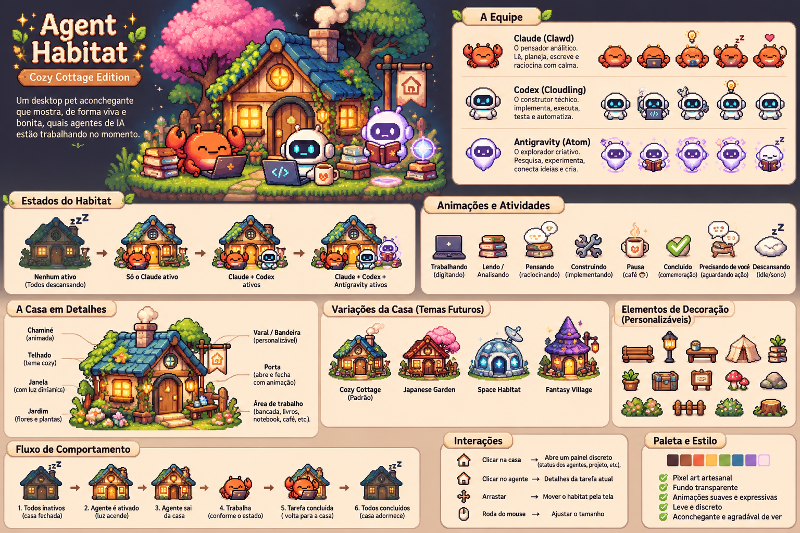

# Agent Habitat — Cozy Cottage Edition

**Um pequeno habitat vivo na área de trabalho do Windows que mostra, sem trocar de janela, quais dos seus agentes de IA estão trabalhando ou precisando de você.**

<p align="center">
  
</p>

> **Status atual:** `0.1.0-kickoff` — Fundação documental concluída sobre a base `playertwo1/clawd-on-desk` (`v1.6.4`). Próxima etapa: **[Gate G0 — Descoberta, Licenças e Isolamento da Base](docs/roadmap/g0-descoberta-e-base.md)**. Acompanhe o andamento em **[`docs/STATE.md`](docs/STATE.md)**.

---

## Como o Habitat Funciona

A **cabana (Cozy Cottage)** permanece discreta sobre o desktop, com fundo transparente real e clique-através nas áreas vazias. Dentro dela moram três companheiros independentes:

| Assistente | Morador | Superfícies suportadas (Windows) | Estação no jardim |
|---|---|---|---|
| **Claude** | **Clawd** | Claude Code CLI + Claude Desktop (aba Code) | Esquerda — livros, notebook e caneca quente |
| **Codex** | **Cloudling** | Codex CLI + extensão/app Desktop | Centro-frente — bancada, laptop `</>` e ferramentas |
| **Antigravity** | **Atom** | Antigravity IDE + Antigravity CLI (`agy`) | Direita — flutuação, livros e orbe luminoso |

### As 8 Cenas Estáveis (`000` a `111`)

Sessão aberta parada (`idle`) **não** tira ninguém de casa. Um morador só cruza a porta quando há **trabalho ativo confirmado** ou **ação sua pendente**:

| Claude | Codex | Antigravity | O que você vê na tela |
| :---: | :---: | :---: | :--- |
| `0` | `0` | `0` | Cabana fechada em repouso, **nenhum mascote fora** |
| `1` | `0` | `0` | Luz âmbar acesa + **Clawd** trabalhando |
| `0` | `1` | `0` | Luz âmbar acesa + **Cloudling** trabalhando |
| `0` | `0` | `1` | Luz âmbar acesa + **Atom** trabalhando |
| `1` | `1` | `0` | **Clawd** + **Cloudling** |
| `1` | `0` | `1` | **Clawd** + **Atom** |
| `0` | `1` | `1` | **Cloudling** + **Atom** |
| `1` | `1` | `1` | **Os três trabalhando simultaneamente** |

Quando a última tarefa termina, o morador comemora brevemente, caminha/flutua de volta pela porta arredondada e a cabana descansa.

### Interações Enxutas
- **Clicar na cabana:** abre o painel sob demanda em pt-BR (estado de cada provedor, contagem de sessões, último evento e saúde da integração).
- **Clicar num morador:** filtra as sessões daquele agente ou foca diretamente o terminal / IDE / Claude Desktop correspondente.
- **Cards locais opcionais:** bolha discreta para aprovar/negar ferramentas (`Allow`/`Deny`), responder perguntas de fim de turno ou ver avisos de conclusão — sempre locais, sem roubar foco e sem enviar nada para fora da sua máquina.

---

## Documentação do Projeto

| Documento | Conteúdo |
|---|---|
| [`docs/STATE.md`](docs/STATE.md) | Ponto único de retomada: onde estamos, próxima ação e pendências do dono |
| [`docs/PRODUCT.md`](docs/PRODUCT.md) | Visão, regras de verdade das 8 combinações, estados e critérios de aceitação P0 |
| [`docs/DESIGN.md`](docs/DESIGN.md) | Norte artístico Cozy Cottage, paleta, camadas PNG RGBA, estações e cadência |
| [`docs/ARCHITECTURE.md`](docs/ARCHITECTURE.md) | Arquitetura sobre a base Electron, janela dupla, máquina de cena e segurança |
| [`docs/ROADMAP.md`](docs/ROADMAP.md) | Índice dos gates `G0`–`G5`, backlog `P1/P2` e matriz de testes `T01`–`T28` |
| [`docs/REFERENCIAS_GITHUB.md`](docs/REFERENCIAS_GITHUB.md) | Fontes primárias (`clawd-on-desk`, `Arnav8452/atom`), commits e diretrizes de licenças |
| [`docs/questionario/`](docs/questionario/2026-11-24-kickoff-agent-habitat.md) | Registro das decisões `D1`–`D8` tomadas no kickoff |
| [`AGENTS.md`](AGENTS.md) | Guia operacional rápido para agentes de código |
| [`CHANGELOG.md`](CHANGELOG.md) | Histórico de entregas e mudanças |

---

## Desenvolvimento Local (Windows)

Pré-requisitos: **Node.js `>= 22.12.0`** (recomendado `24.18.0` conforme `.nvmrc`) e **Git**. Todas as validações, builds e releases são **100% locais via CLI** (zero GitHub Actions).

```powershell
# Instalar dependências
npm install

# Rodar a suíte de testes automatizados
npm test

# Iniciar em desenvolvimento (após concluir o isolamento de porta/appId no Gate G0.3)
npm start

# Gerar instalador Windows x64 localmente
npm run build:win:x64
```

---

## Licença e Direitos Autorais

- **Código-fonte:** licenciado sob a **[GNU Affero General Public License v3.0](LICENSE)** (`AGPL-3.0-only`), derivado de [`playertwo1/clawd-on-desk`](https://github.com/playertwo1/clawd-on-desk) / [`rullerzhou-afk/clawd-on-desk`](https://github.com/rullerzhou-afk/clawd-on-desk). Avisos de componentes de terceiros constam em [`NOTICE.md`](NOTICE.md).
- **Personagens e artes:** os sprites de **Clawd**, **Cloudling** e **Atom** **não** são cobertos pela licença AGPL-3.0 do código e pertencem aos seus respectivos autores/detentores (veja [`assets/LICENSE`](assets/LICENSE) e [`docs/REFERENCIAS_GITHUB.md`](docs/REFERENCIAS_GITHUB.md)). As imagens em `docs/referencias_visuais/` são pranchas conceituais de direção de arte.
