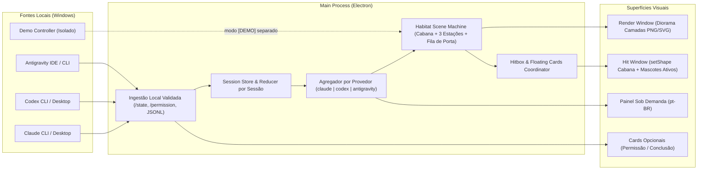

# Arquitetura Técnica — Agent Habitat

## 1. Decisão de Base Tecnológica (`ADR-001` / `D2`)

O **Agent Habitat** parte da base comprovada do fork `playertwo1/clawd-on-desk` (`v1.6.4`, commit `e216f924`, **Electron + Node.js CJS**, licença **AGPL-3.0**), em vez de reescrever um shell do zero.

### O que reaproveitamos diretamente da base
- **Modelo de janela dupla no Windows (`src/pet-window-runtime.js`, `src/topmost-runtime.js`, `src/hit-geometry.js`):**
  - `renderWin`: janela transparente com `setIgnoreMouseEvents(true)` permanente (zero bloqueio em áreas vazias);
  - `hitWin`: janela de captura moldada via `setShape` exatamente sobre a cabana e os mascotes visíveis, com controle nativo `WS_EX_NOACTIVATE` para não roubar foco em tela cheia.
- **Ingestão e hooks maduros (`src/server.js`, `hooks/`, `agents/`):**
  - **Claude Code** (`hooks/clawd-hook.js`, `hooks/install.js`, `src/claude-settings-watcher.js`): CLI + Claude Desktop (`CLAUDE_CODE_ENTRYPOINT=claude-desktop`), backup atômico e preservação de hooks existentes;
  - **Codex** (`hooks/codex-hook.js`, `hooks/codex-install.js`, `agents/codex-log-monitor.js`): hooks oficiais primários + fallback JSONL (`~/.codex/sessions/rollout-*.jsonl`) e turn fence;
  - **Antigravity CLI** (`hooks/antigravity-install.js`, `hooks/antigravity-hook.js`): hooks em `~/.gemini/config/hooks.json` com wrapper PowerShell fail-open sem BOM UTF-8 (`#638`).
- **Foco de janela e cards locais (`src/focus.js`, `src/win-foreground-terminal.js`, `src/permission.js`):**
  - Pulo de um clique para o terminal, VS Code/Cursor ou instância específica do Claude Desktop (`142c2003`);
  - Cards locais opcionais de permissão (`Allow`/`Deny`), pergunta de fim de turno e conclusão (`adc00498`, `21853ee5`, `5f18fc07`).

### O que muda para virar o Agent Habitat
1. **De 1 pet único para Máquina de Cena de Habitat (`src/habitat/`):**
   Em vez de fundir todas as sessões de todos os agentes num único sprite (`resolveDisplayState` global), o agregador passa a produzir **3 slots independentes por provedor** (`claude`, `codex`, `antigravity`) + o **estado da cabana** (`sleeping`, `waking`, `active`, `door-opening`, `door-closing`).
2. **Enxugamento de escopo (`D3`, `D4`):**
   - Registro ativo focado nos **3 provedores moradores** (`claude-code`, `codex`, `antigravity-cli` + conector Antigravity IDE validado na G0);
   - Desativação/remoção na UI de canais remotos (Telegram, Feishu/Lark, Slack, PWA mobile), Remote SSH e dos 26 agentes extras não escopados;
   - Localização **100% pt-BR** e identidade própria (`appId`, ícone da cabana, protocolo e updater apontando para `playertwo1/agent-habitat`).
3. **Integração da superfície Antigravity IDE (`G0` / `G2`):**
   - Auditar no Gate G0 o mecanismo do `Arnav8452/atom` (`aae0dfe8603a82a699b210dd8c8ca717ebea31f1`, licença MIT) em conjunto com os hooks globais do Antigravity (`~/.gemini/config/hooks.json`) para garantir distinção real entre "IDE aberta ociosa" (`idle` → dentro da cabana) e "agente trabalhando/aguardando" (`busy`/`waiting` → Atom fora da cabana).

## 2. Fluxo de Dados do Habitat



## 3. Contrato do Snapshot do Habitat

O snapshot compartilhado entre `Habitat Scene Machine`, `Hit Window` e `Painel do Habitat` separa estritamente `mode: "observed" | "demo"` e mantém o estado de cada morador independente:

```json
{
  "schema": 1,
  "mode": "observed",
  "cottage": {
    "lights": "amber",
    "door": "closed",
    "smoke": true
  },
  "residents": {
    "claude": {
      "character": "clawd",
      "presence": "outside",
      "state": "busy",
      "visualClip": "typing",
      "activeSessionCount": 2,
      "idleSessionCount": 1,
      "integrationHealth": "healthy",
      "lastEventAt": 1795564800000
    },
    "codex": {
      "character": "cloudling",
      "presence": "inside",
      "state": "idle",
      "visualClip": null,
      "activeSessionCount": 0,
      "idleSessionCount": 1,
      "integrationHealth": "healthy",
      "lastEventAt": 1795564500000
    },
    "antigravity": {
      "character": "atom",
      "presence": "outside",
      "state": "waiting_input",
      "visualClip": "attention",
      "activeSessionCount": 1,
      "idleSessionCount": 0,
      "integrationHealth": "healthy",
      "lastEventAt": 1795564810000
    }
  }
}
```

### Invariantes do Reducer e da Máquina de Cena
- **Isolamento por `(provider, sessionId)`:** `SessionEnd` ou `Stop` de uma sessão jamais limpa outra sessão ativa do mesmo provedor.
- **Cena `000` garantida:** quando `claude`, `codex` e `antigravity` têm `activeSessionCount === 0` e nenhuma transição `done`/`exiting`/`entering` em curso, `presence === "inside"` para os três e `cottage.lights === "night"`.
- **Fila curta de porta (`doorQueue`):** se dois agentes iniciarem no mesmo milissegundo, a porta abre uma vez e permanece aberta até o último morador em trânsito cruzar a soleira (`exiting` ou `entering`), fechando sem piscar.
- **Interrupção limpa no retorno:** se `state` voltar para `busy` / `needs_approval` durante `entering`, o morador inverte imediatamente para `outside` rumo à sua estação sem precisar entrar e sair de novo.
- **Reconciliação de órfãos:** se o processo de origem morrer sem enviar `SessionEnd`, a varredura de PIDs vivos rebaixa a sessão sem eternizar mascote fora da cabana.

## 4. Segurança, Privacidade e Hooks Reversíveis

- **Loopback estritamente local (`127.0.0.1`):** nenhum endpoint exposto na LAN; canais remotos desativados.
- **Sem coleta de código ou prompts:** logs locais e estado em memória guardam apenas metadados operacionais de sessão, tipo de evento, ferramenta e carimbo de tempo; zero telemetria externa.
- **Sem aprovação silenciosa:** ferramentas nunca recebem `Allow` sem clique explícito do usuário (ou configuração explícita dele); na falta de resposta, falha ou DND, retorna `no-decision` para o fluxo nativo do agente.
- **Hooks reversíveis e com backup:** toda escrita em `~/.claude/`, `~/.codex/` ou `~/.gemini/config/hooks.json` faz backup atômico, marca apenas entradas gerenciadas pelo app e preserva qualquer hook de terceiros ou skills do usuário.
- **Zero GitHub Actions:** toda validação (`npm test`, auditoria de pacote, build NSIS x64/arm64 e upload de release) é executada localmente via CLI.

## 5. Metas Operacionais no Windows

- **Hit-testing cirúrgico:** `hitWin` cobre apenas a silhueta útil da cabana + estações ativas; cliques no resto do retângulo transparente atravessam 100%.
- **Repouso econômico (`000`):** quando a cabana está fechada e sem moradores fora, pausar loops de animação e timers visuais desnecessários para manter CPU próxima de `0%`.
- **Latência de reação:** evento local confirmado via hook → início de abertura da porta / reação visual em `< 500 ms` (meta p95 `≤ 1 s`).
- **Nenhum roubo de foco:** nem a cabana, nem a saída de mascote, nem o aparecimento de card tiram o foco do editor ou terminal ativo.
